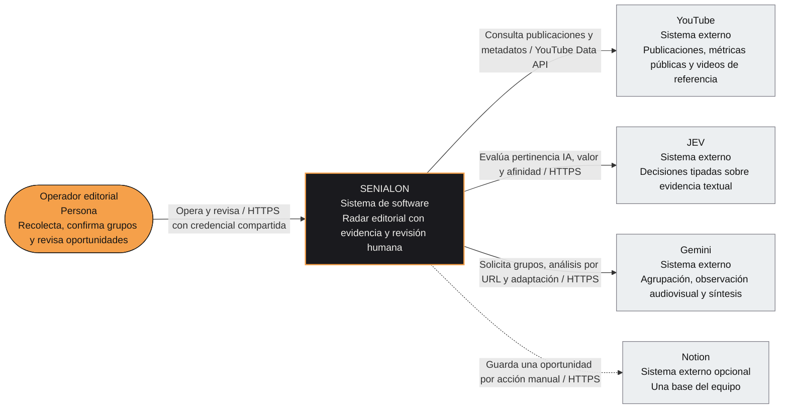
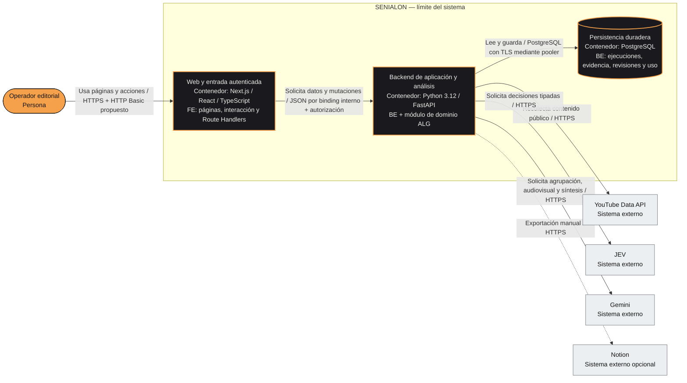
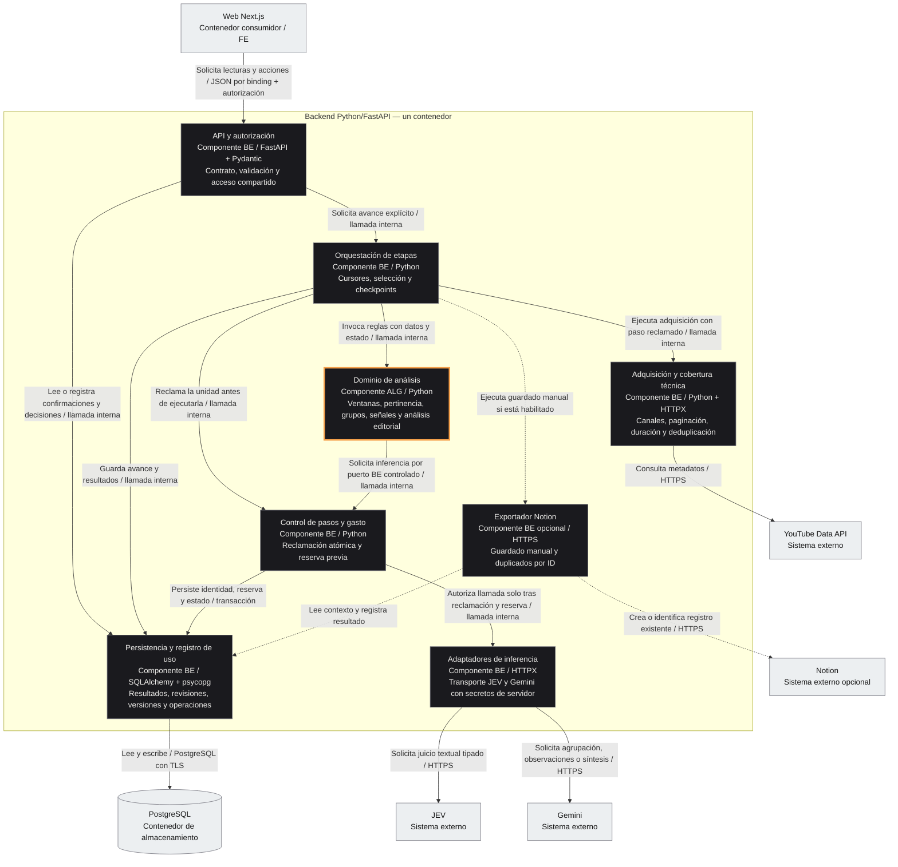
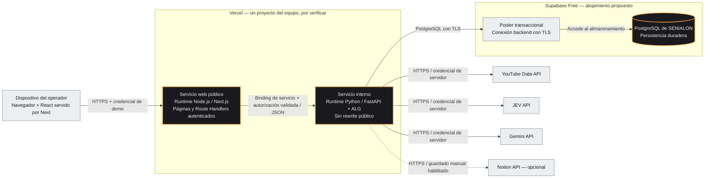

# Arquitectura C4 de SENIALON

**Estado:** arquitectura objetivo, previa a implementación. **Fecha:** 17 de octubre de 2026, America/Bogota.

Este documento representa el [diseño técnico](../openspec/changes/definir-mvp-senialon/design.md), las [specs](../openspec/changes/definir-mvp-senialon/proposal.md) y el [plan de tres áreas](PLAN_DE_TRABAJO.md). No acredita servicios desplegados, integraciones probadas o código construido. Si cambia una decisión, actualizar primero su fuente y después estas vistas.

Los niveles C1, C2 y C3 se expresan con diagramas Mermaid y etiquetas de tipo, tecnología y responsabilidad. En C4, un contenedor representa una aplicación o almacenamiento; aquí no implica Docker. El despliegue se muestra aparte. No se inventa el nivel de código C4: las clases y funciones concretas se documentarán cuando exista implementación. [Modelo C4](https://c4model.com/diagrams), [contenedores](https://c4model.com/diagrams/container), [componentes](https://c4model.com/diagrams/component).

## Leyenda y decisiones de partida

| Elemento | Significado |
| --- | --- |
| Persona | Operador editorial que utiliza la credencial compartida de demo. |
| Sistema SENIALON | Aplicación que reúne publicaciones, señales temáticas y oportunidades revisables. |
| Contenedor | Unidad lógica de ejecución o almacenamiento: web Next.js, backend Python o PostgreSQL. |
| Componente | Módulo dentro de un contenedor; no se despliega como servicio independiente. |
| Sistema externo | YouTube, JEV, Gemini o Notion. |
| Línea continua | Relación del recorrido esencial; no significa que esté implementada. |
| Línea discontinua | Extensión opcional de Notion, de última prioridad. |
| FE / ALG / BE | Dueños: Frontend / Algoritmia-JEV / Backend e infraestructura. |

**Confirmado:** frontend con Next.js/App Router, React y TypeScript; Python para análisis; despliegue en Vercel; credencial compartida; persistencia duradera; tres áreas; máximo de 20 USD de nuevos consumos, con la suscripción Vercel pagada aparte.

**Propuesto y por comprobar:** FastAPI, PostgreSQL en Supabase Free, HTTP Basic sobre HTTPS y Vercel Services con Next público y Python interno mediante binding. Las versiones frontend de referencia y las pruebas pendientes están en el diseño técnico. Los diagramas describen esta ruta propuesta.

## C1 — Contexto del sistema

**Alcance:** SENIALON como un único sistema y sus relaciones con la persona operadora y proveedores funcionales. Vercel y Supabase son plataformas de alojamiento y se detallan en la vista de despliegue.

El corpus es la lista fija de once canales de la [definición del MVP](DEFINICION_MVP.md). Se observan publicaciones públicas de hasta 180 segundos y pertinencia de IA, sin búsqueda global ni acceso detrás de login de terceros. JEV juzga evidencia textual; Gemini es la ruta propuesta para observar videos públicos por URL. No se atribuye a JEV procesamiento audiovisual ni redacción de guiones.

## C2 — Contenedores

**Alcance:** contenedores lógicos de SENIALON, comunicación y tecnologías. La base de datos es parte lógica del sistema aunque su alojamiento sea externo al proyecto Vercel.

| Contenedor | Responsabilidad y límites |
| --- | --- |
| Web Next.js | Sirve la interfaz y ejecuta las rutas de servidor que consumen FastAPI. React en el navegador forma parte de esta entrega web; no se propone una SPA independiente. Next valida el acceso, las respuestas y el origen de mutaciones. No calcula ventanas/señales ni accede directamente a PostgreSQL o proveedores. |
| Backend Python | Valida otra vez la credencial, publica el contrato API, adquiere YouTube, orquesta etapas, inyecta adaptadores a ALG y persiste resultados. El módulo ALG comparte el runtime Python; no es microservicio, worker o despliegue separado. |
| PostgreSQL | Conserva ejecuciones, fronteras temporales, cobertura, publicaciones/capturas, clasificaciones, grupos y confirmación, análisis, evidencia/revisión, decisiones, pasos y uso/reservas. No se usa memoria del navegador o filesystem de la función como almacenamiento duradero. |

El binding concede conectividad interna, pero la autenticación de aplicación se verifica en ambos servicios. Las llamadas salen desde funciones de servidor de Next; no dependen de llamadas a otros servicios durante build o middleware. El navegador solo utiliza SENIALON por su origen web, además de abrir enlaces originales de evidencia.

## C3 — Componentes del backend Python

**Alcance:** descomposición del contenedor Python/FastAPI. Los nombres describen responsabilidades propuestas; no son clases, archivos o endpoints ya existentes. FE solo consume el contrato; los componentes internos pertenecen a BE, salvo el módulo de dominio ALG.

Las flechas internas indican uso y no duplican las respuestas de cada llamada. El resultado de proveedor vuelve al puerto de análisis y después al orquestador para validación/persistencia. Cada inferencia dentro de un lote tiene identidad y control previo; reservar una etapa global no permite llamadas ilimitadas desde ALG. El adaptador no ofrece una vía alternativa que omita ese control.

### Dominio de análisis: funciones y proveedores

| Responsabilidad ALG | Implementación prevista | Entrada y salida esenciales |
| --- | --- | --- |
| Ventanas y comparación | Python determinista | Instante de ejecución → dos ventanas completas en America/Bogota; IDs/clasificación confirmada/cobertura → conteos y variación permitida. |
| Pertinencia de IA | Preguntas y criterio ALG; JEV mediante adaptador BE | Texto/evidencia disponible → pertinente, no pertinente o insuficiente, con procedencia. |
| Grupos y asignación | Prompts/validación ALG; Gemini mediante adaptador BE | Material de ambas ventanas → una versión de temas canónicos, principal único y secundarios sin conteo. |
| Observación audiovisual | Prompts/validación ALG; Gemini mediante adaptador BE | URL pública de una pieza seleccionada → observaciones y marcas temporales, con dimensiones faltantes y revisión. |
| Valor y afinidad | Rúbricas ALG; JEV mediante adaptador BE | Evidencia textual del contenido → valor de tres resultados y afinidad separada por persona, contexto y pilar. |
| Hipótesis y adaptación | Síntesis ALG; Gemini mediante adaptador BE | Observaciones y decisiones respaldadas → hipótesis, ángulo, aporte, gancho, estructura y CTA cuando proceda. |

ALG no carga claves, realiza HTTP, escribe en la base de datos ni administra reintentos. BE no redefine sus rúbricas o cálculos. Las fechas y las variaciones no se delegan a un modelo de lenguaje.

## Despliegue propuesto — entorno de demo

**Alcance:** ubicación prevista de los contenedores. Services, binding, runtimes, región, límites efectivos y primer despliegue todavía deben comprobarse en la cuenta del equipo. No se inventan dominio, región, réplicas o capacidad.

La credencial de demo se configura como secreto en ambos servicios. Las claves de proveedores y la conexión PostgreSQL pertenecen al backend. No se incluyen secretos en diagramas, repositorio, bundle cliente o logs. No se necesita Supabase Auth para la credencial compartida propuesta.

Cada solicitud de trabajo debe caber en los límites configurados tanto de Node como de Python, incluido el retorno. Se envían URLs y resultados estructurados; no se propone guardar videos. La aplicación avanza por solicitudes acotadas y recupera checkpoints; no incluye una cola, worker permanente o promesa de trabajo autónomo después de cerrar el navegador.

## Flujo de ejecución y puntos de control

| Paso | Recorrido | Condición obligatoria |
| --- | --- | --- |
| 1. Crear o recuperar ejecución | Operador → Next → API → persistencia | Credencial válida en ambos servicios. Guardar instante, ventanas y versión; identificar ejecuciones anteriores. |
| 2. Recolectar | Orquestación → adquisición → YouTube → persistencia | Paso reclamado; fronteras calculadas por ALG; once fuentes conservadas con estados, duración pública elegible y deduplicación. |
| 3. Clasificar y proponer grupos | Orquestación → ALG → puerto controlado → JEV/Gemini | Cada llamada con control previo y uso registrado; JEV decide pertinencia, Gemini propone grupos de ambas ventanas; guardar evidencia y versión. |
| 4. Confirmar y comparar | Operador → Next → API → confirmación persistida → ALG | Sin confirmación no hay comparación. Un ID contribuye solo a su tema principal. Base desconocida no es cero; cobertura parcial mantiene pendiente la comparación completa. |
| 5. Analizar una pieza | Operador → Next → API → ALG → puertos controlados | La selección puede hacerse desde cualquier pieza elegible, aunque no haya crecimiento o la comparación esté pendiente. No analizar profundamente las otras por defecto. |
| 6. Evaluar y adaptar | Gemini → observaciones → JEV → síntesis Gemini → persistencia | Separar observaciones, valor, afinidad, hipótesis y propuestas; conservar marcas temporales, criterios/modelos y límites. |
| 7. Revisar | Operador → Next → API → persistencia | Decisión y motivo vinculados al análisis exacto. Guardar o confirmar grupos no equivale a aprobación editorial. |
| 8. Exportar, si se activa | Operador → Next → API → exportador → Notion | Última prioridad, acción manual, enlace de éxito real y control de duplicados; error sin pérdida local. |

La cobertura temática depende de adquisición, elegibilidad, pertinencia y tema principal resueltos en ambas ventanas. La falta de observación audiovisual profunda, formato, valor o afinidad no invalida por sí sola un conteo temático conocido. Métricas originales, señal de publicaciones, valor y afinidad se conservan como dimensiones distintas.

Si el proveedor no confirma el resultado de una llamada pagada, conservar la operación como incierta y su reserva hasta reconciliar o decidir un reintento informado. No convertir la incertidumbre en error definitivo con repetición pagada automática. El gasto incremental considera consumo confirmado y reservas, frente a los 20 USD autorizados.

## Correspondencia con responsables y tareas

| Área | Parte del modelo que implementa | Tareas |
| --- | --- | --- |
| FE | Contenedor web: React, páginas, Route Handlers, acceso web, consumo del contrato, revisión, evidencia y pruebas E2E; playbook. | [1.1–1.12](../openspec/changes/definir-mvp-senialon/tasks.md) |
| ALG | Componente de dominio backend/analysis/: ventanas, reglas, prompts/rúbricas, agrupación, señales, análisis editorial y evaluación. | [2.1–2.12](../openspec/changes/definir-mvp-senialon/tasks.md) |
| BE | API, autorización interna, adquisición, adaptadores, control de pasos/gasto, persistencia, exportador opcional, infraestructura y entrega. | [3.1–3.18](../openspec/changes/definir-mvp-senialon/tasks.md) |

BE publica el borrador del contrato API; ALG revisa su semántica y FE su consumo; BE cierra una versión común antes de integrar. Este archivo no crea endpoints, taxonomías, componentes obligatorios adicionales ni una nueva lista de tareas. La descomposición expresa las responsabilidades del diseño existente.

## Estado de dependencias y validación pendiente

| Dependencia | Estado documental | Antes de considerarla operativa |
| --- | --- | --- |
| Vercel | Configurado según el equipo, plan de pago abonado aparte | Verificar Services, dos runtimes, binding, autenticación, límites y URL real desde otro equipo. |
| Gemini | Configurado según el equipo | Probar URL pública, observaciones y tiempos contrastables, modelo, errores y uso. |
| YouTube Data API | Sin configurar según el último estado informado | Habilitar acceso, resolver canales y obtener metadatos/cobertura reales. |
| JEV | Sin configurar según el último estado informado | Probar decisiones auténticas y sus criterios, uso, facturación y límites. |
| PostgreSQL / Supabase | Propuesto, por configurar | Probar conexión, escritura, recuperación tras reinicio y respaldo permitido. |
| Notion | Opcional, por confirmar | Activar solo al final; comprobar guardado y enlace reales o dejar pendiente. |

Las fuentes del modelo son la [definición del MVP](DEFINICION_MVP.md), el [plan de trabajo](PLAN_DE_TRABAJO.md), el [diseño técnico](../openspec/changes/definir-mvp-senialon/design.md) y las seis specs de [la propuesta](../openspec/changes/definir-mvp-senialon/proposal.md). La sintaxis de los diagramas usa [Mermaid flowchart](https://mermaid.js.org/syntax/flowchart.html); su presentación depende del visor utilizado.
