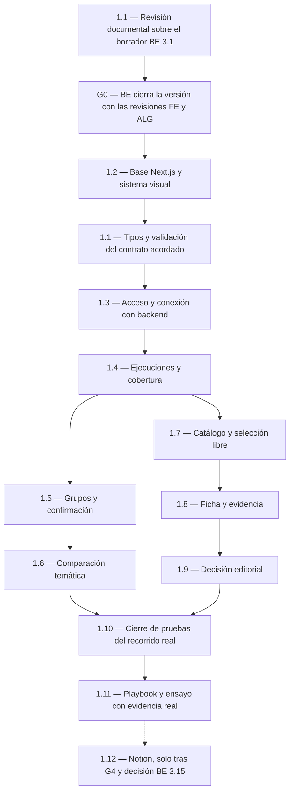

# Plan de frontend de SENIALON

**Responsable confirmado:** tú, como integrante FE del equipo. **Estado:** revisión documental FE 1.1 emitida con observaciones; conformidad y G0 todavía pendientes, sin código del producto implementado. La última confirmación autoriza esa revisión, sin iniciar automáticamente Next.js 1.2 ni el segundo hito técnico. La entrega sigue siendo el 18 de octubre de 2026 antes de las 12:00, America/Bogota; no se asignan duraciones sin disponibilidad confirmada.

Las doce tareas y sus casillas siguen en [tasks.md](../openspec/changes/definir-mvp-senialon/tasks.md). Este documento prepara su prioridad, dependencias y orden; no crea otra lista de estados ni cambia sus IDs. Referencias: [plan del equipo](PLAN_DE_TRABAJO.md), [diseño técnico](../openspec/changes/definir-mvp-senialon/design.md), [C4](ARQUITECTURA_C4.md) y [DESIGN.md](../DESIGN.md).

## Por cuál empezar

**Empieza por 1.1: revisión documental del contrato API con Backend.** La primera acción es preparar el inventario de datos, estados y operaciones que necesita la interfaz y contrastarlo con el borrador de BE 3.1. ALG revisa la semántica en 2.1; BE publica la versión acordada. No esperar a que BE cierre 3.1 para comenzar a revisar su borrador.

Tras la inspección inicial sin contrato se preparó el [borrador API `0.1.0-draft.1`](contracts/README.md). Su [revisión FE](REVISION_CONTRATO_FRONTEND.md) ya contrasta diez necesidades, veinte casos y ocho observaciones: la mayor parte del transporte es consumible, pero quedan recuperación de operación retenida (H01), procedencia de agrupación (H02), traza parcial JEV (H03) y aclaración de capacidades históricas con pauta FE (H04). ALG 2.1 y la versión común siguen pendientes; el contrato no fue editado en la revisión y no hay frontend/backend implementados.

Para evitar un ciclo, **1.1 tiene dos hitos dentro de la misma tarea**:

- **Revisión documental:** inventario, ejemplos, campos, estados y conformidad de FE sobre el borrador. Esto es lo que necesita el cierre del contrato G0; no requiere código ni crear tipos TypeScript.
- **Consumo técnico:** después de 1.2, preparar tipos y validación de respuestas del contrato acordado y comprobar su consumo. La casilla 1.1 se completa al verificar ambos hitos; no tiene que estar marcada completa para cerrar G0.

Después de G0 y cuando se inicie el desarrollo, la primera tarea de construcción es **1.2: base de Next.js y aplicación del sistema visual**. No necesita esperar a que YouTube, JEV o Gemini funcionen; sí respeta el stack y el contrato acordados.

## Prioridad y orden recomendado

- **P0 — Desbloqueo y verificación:** habilita el trabajo posterior o comprueba que el recorrido funciona. Obligatorio.
- **P1 — Núcleo y entrega:** funcionalidad editorial y materiales exigidos para la demo. También obligatorio; no significa prescindible.
- **P2 — Extensión:** Notion, únicamente si cabe después del núcleo, evaluación y preparación de entrega.

| Orden sugerido | Prioridad | Tarea existente | Resultado que debes entregar |
| --- | --- | --- | --- |
| 1 | P0 | 1.1, revisión documental | Necesidades de la interfaz revisadas contra el borrador, con dudas resueltas y versión de contrato registrada por BE. |
| 2 | P0 | 1.2, base frontend | Next.js/App Router, React, TypeScript, estilos y logos; arranque/build locales y comandos entregados a BE. |
| 3 | P0 | 1.1, consumo técnico | Tipos y validación durante la ejecución para respuestas, estados y errores. Es la misma tarea 1.1, no otra casilla. |
| 4 | P0 | 1.3, acceso y conexión | Páginas y Route Handlers protegidos; comunicación autenticada con FastAPI por el binding interno. |
| 5 | P0 | 1.4, ejecuciones y cobertura | Contexto de ejecución, ventanas, canales, errores, consulta de estado y reanudación sin consumo desde lecturas. |
| 6 | P1 | 1.7, catálogo y selección | Elegir una publicación elegible sin exigir crecimiento, grupos confirmados o comparación disponible. |
| 7 | P1 | 1.5, grupos | Inspección y confirmación explícita de una versión, sin edición manual de clasificaciones. |
| 8 | P1 | 1.6, comparación temática | Conteos, diferencia, porcentaje permitido, base cero, faltantes y fuentes, recibidos del backend. |
| 9 | P1 | 1.8, ficha y evidencia | Metadatos, señal, audiovisual, valor, afinidad, hipótesis y adaptación con estados separados. |
| 10 | P1 | 1.9, revisión editorial | Decisión y motivo guardados y recuperables, asociados al análisis exacto. |
| Continua; cierre tras el núcleo | P0 | 1.10, calidad y E2E | Comprobaciones desde la base; al final, recorrido real protegido, persistente y reproducible desde otro equipo. |
| Borrador temprano; cierre tras verificación | P1 | 1.11, playbook y demo | Documento de máximo cinco páginas u ocho diapositivas y guion con evidencia, evaluación y costos reales. |
| Última | P2 | 1.12, Notion | Interfaz real sobre la API de BE, o constancia de que se difirió sin simular guardado. |

El orden entre 1.5–1.6 y 1.8–1.9 se adapta a las entregas disponibles: **son dos rutas independientes**. Después del catálogo, puedes construir la ficha y la revisión sin esperar la comparación. Si los grupos y señales llegan primero, integra esa ruta antes. No dejar calidad o el borrador del playbook para cuando termine toda la interfaz.

## Dependencias verificadas por tarea

La preparación visual o las pruebas con ejemplos no equivalen a integración real. Las dependencias de BE/ALG se refieren a **la operación o salida indicada**, no al cierre completo de una tarea que también incluya otros entregables. Por ejemplo, usar el catálogo de 3.11 no exige esperar a que esa misma tarea termine el análisis audiovisual.

| Tarea FE | Base de frontend necesaria | Entrega externa para integración y cierre |
| --- | --- | --- |
| **1.1** | Revisión documental primero; 1.2 antes de completar tipos/validación. | Borrador de **BE 3.1**; revisión semántica de **ALG 2.1** para acordar la versión. BE cierra G0 con la revisión documental, sin esperar los tipos programados. |
| **1.2** | G0 cerrado antes de construcción. Se puede preparar el inventario de componentes y requisitos de entorno durante la revisión documental. | No necesita APIs de proveedores. Entrega comandos de arranque/build y nombres de variables a **BE 3.3**; el despliegue no es condición para terminar el arranque local de esta tarea. |
| **1.3** | Base 1.2 y consumo técnico de 1.1. | Contrato de autorización de **BE 3.1**, binding/servicios de **BE 3.3** y autenticación FastAPI de **BE 3.6**. El cierre exige probar ambos servicios, no solo Next con un ejemplo local. |
| **1.4** | Acceso y cliente API de 1.3. | Operaciones de ejecución/estado de **BE 3.11**, persistencia **3.5**, cobertura **3.9** y pasos **3.10**; ventanas de **ALG 2.2**. No espera grupos o análisis audiovisual para mostrar avance y fallos disponibles. |
| **1.5** | Contexto y navegación de 1.4, más acceso/cliente API. | Grupos de **ALG 2.3–2.4** expuestos por **BE 3.11** y operación de confirmación de **BE 3.12**. Requiere inspección y confirmación reales para cerrar su recorrido. |
| **1.6** | Contexto de 1.4. La presentación de estados puede prepararse antes; el recorrido real incluye confirmación mediante 1.5. | Conteos/variaciones de **ALG 2.5–2.6**, exposición de **BE 3.11** y confirmación persistida de **BE 3.12**. No hay porcentajes del corpus completo con cobertura parcial. |
| **1.7** | Acceso de 1.3 y contexto/navegación de 1.4. | Corpus de **BE 3.8–3.9**, pertinencia de **ALG 2.3** y operaciones de listado/selección de **BE 3.11**. **No depende de 1.5, 1.6 ni de ALG 2.4–2.6.** |
| **1.8** | Selección y contexto de publicación de 1.7. | Salidas de **ALG 2.7–2.9**, adaptadores **BE 3.7**, control de pasos/gasto **3.10** y operación de análisis/lectura **3.11**. Puede representar la señal como pendiente; no espera a 1.6 para funcionar. |
| **1.9** | Un análisis identificable y el contexto de ficha de 1.8; el formulario puede prepararse antes del audiovisual real. | Persistencia de **BE 3.5** y guardado/recuperación de decisión y revisión de **BE 3.12**. Un análisis real parcial sirve solo si su estado permite la operación según el contrato; no se inventan análisis o transiciones. |
| **1.10** | Se ejecuta progresivamente desde 1.2; cierre con 1.3–1.9 integradas. | Ruta real validada por **ALG 2.11**, pruebas de integración **BE 3.13**, despliegue protegido y persistencia. Ejemplos de prueba no sustituyen esta evidencia. |
| **1.11** | Puede iniciarse como esquema desde la revisión documental; cierre con evidencia de 1.10 y ensayo. | Evaluación/criterios de **ALG 2.10–2.12** y operación/costos de **BE 3.14**. Entrega el playbook a **BE 3.18**. Contribuye a G4, por lo que **no espera a G4 para comenzar o cerrarse**. |
| **1.12** | G4 completo y decisión sobre la extensión. | **BE 3.15** decide activación. Si se activa, **BE 3.16** debe entregar API y guardado operativo. Si se difiere, documentar la rama sin esperar una API que no se construirá. |

## Mapa de precedencias

Este diagrama muestra las precedencias de integración del frontend. Los nodos de 1.10 y 1.11 representan sus cierres; sus comprobaciones y borradores comienzan antes. Las entregas externas necesarias se detallan en la tabla anterior.

La ruta de catálogo/ficha/revisión no depende de que existan resultados de comparación. La condición funcional «confirmar grupos antes de calcular» sigue aplicando a la otra ruta. El orden del frontend no cambia las reglas analíticas.

## Primer entregable de 1.1: inventario para revisar con BE

Preparar y contrastar estos puntos con el borrador único de Backend; no crear URLs, nombres de campos o enums definitivos por cuenta del frontend:

| Operación o dato requerido | Qué debe quedar resuelto en el contrato |
| --- | --- |
| Ejecuciones | Crear, recuperar y distinguir una ejecución anterior; IDs, fechas y ventanas devueltas por el servidor. |
| Cobertura y estado | Once canales previstos, datos consultados/fallidos, etapa, motivo, último paso confirmado y acción de avance permitida. |
| Grupos | Consultar propuesta y pertenencias; confirmar una versión con fecha sin edición manual de clasificaciones. |
| Comparación | A/B conocidos o desconocidos, diferencia permitida, porcentaje aplicable o motivo de pendiente y fuentes/contribución por canal. |
| Catálogo y selección | Publicaciones elegibles y sus IDs/URLs, fecha/duración, candidato corto o Short confirmado; operación explícita de análisis. |
| Ficha | Métricas/captura, señal, observaciones con marcas y revisión, hipótesis, decisiones JEV de valor/afinidad y adaptación. |
| Revisión editorial | Identidad/versiones del análisis, decisiones permitidas, motivo, guardado confirmado y lectura posterior. No inventar una taxonomía desde el diseño. |
| Acceso y errores | Credencial compartida, autorización entre servicios, formato de error/insuficiencia, caché privada y tratamiento de fallos. Secretos fuera de documentos y repositorio. |
| Reintentos | Identidad de operaciones, consultas que no consumen, estados en proceso/inciertos y cuándo corresponde reintentar. El frontend no crea un ciclo de llamadas pagadas. |

La evidencia de este primer hito es una revisión documental con observaciones resueltas y versión acordada por BE. Un ejemplo de JSON sirve para acordar el formato; no acredita adquisición o inferencia real ni completa por sí solo 1.1.

## Cómo avanzar si otra entrega no está lista

| Falta | Trabajo que puedes preparar sin invadir otra área | Qué no se considera terminado |
| --- | --- | --- |
| Borrador de contrato | Inventario anterior; mapa de pantallas, acciones y estados; revisión de DESIGN.md y requisitos de Node/npm. | G0, tipos consumidores finales y conexión con endpoints no definidos. El inicio está autorizado; esta dependencia documental debe resolverse antes de 1.2. |
| Backend operativo, con G0 cerrado y desarrollo iniciado | Componentes, estados vacíos/error/parcial y pruebas con ejemplos identificados del contrato. | Acceso entre servicios, persistencia, consumos reales y cierre integrado de la tarea. |
| Grupos o señales | Catálogo elegible, selección y ficha con comparación pendiente si sus operaciones ya están disponibles. | Resultados de comparación, confirmación o crecimiento que el servidor no haya producido. |
| Audiovisual/JEV | Estructura de ficha, estados de información insuficiente/error y formulario de revisión con ejemplos de prueba. | Evidencia observada, evaluación real o decisión guardada sobre un análisis inexistente. |
| Evaluación o costos | Esquema del playbook y guion, con los datos pendientes identificados. | Playbook final con cifras o verificaciones que no hayan entregado ALG/BE. |

Los ejemplos de desarrollo deben respetar el contrato y quedar identificados. No se muestran como resultados de SENIALON ni se introducen en la demo para completar un recorrido ficticio. Una tarea puede estar en preparación mientras espera integración, sin marcarse completa.

## Verificación y límites de tu área

Cada pantalla incorpora su comprobación al construirse: teclado/foco, lectura en móvil, estados de carga/error/parcial, desconocido distinto de cero y accesos protegidos. 1.10 consolida esas comprobaciones y el recorrido real; no es el momento de empezar todas las pruebas.

FE es dueño del frontend, sus Route Handlers, validación del consumidor, DESIGN.md, pruebas E2E y playbook. Backend conserva FastAPI, secretos, proveedores, base de datos, control de gasto y despliegue; Algoritmia conserva criterios y cálculos. Solicitar el cambio a su dueño en vez de escribir un reemplazo dentro del frontend. No se han enviado mensajes a otras personas. La primera tarea ha comenzado con su entregable documental; la casilla permanece abierta hasta completar sus dos hitos.

El núcleo y la entrega requieren **1.1–1.11**; Notion **1.12** es la única tarea opcional de frontend. Si el tiempo no alcanza, simplificar acabado secundario y diferir Notion, conservando acceso, evidencia, cobertura, revisión recuperable y pruebas esenciales. El estado se actualiza en las casillas originales de OpenSpec.

## Decisión sobre el orquestador de referencia

Se inspeccionó en modo de solo lectura el orquestador local de personal-finance-assistant: skill local-orchestration, configuración de agentes, reconciliador y tracker. No es una dependencia genérica instalada por paquete: utiliza fuentes y tareas de Spec Kit, cuatro agentes, políticas y rutas específicas del proyecto financiero.

**Decisión para esta entrega: continuar sin portarlo.** Reutilizarlo exigiría adaptar la fuente de tareas a OpenSpec, fronteras de archivos y políticas de ejecución. La inspección no aporta una medición de ahorro de tiempo o calidad que justifique ese trabajo, y el portado no resuelve la dependencia de BE 3.1. No se instaló, ejecutó ni copió el tracker financiero.

Se conservan los controles aplicables mediante el flujo actual: una tarea acotada, propiedad exclusiva de archivos, criterios de aceptación, comprobaciones pertinentes y revisión independiente. No se garantiza una reducción de tiempo sin medición.
